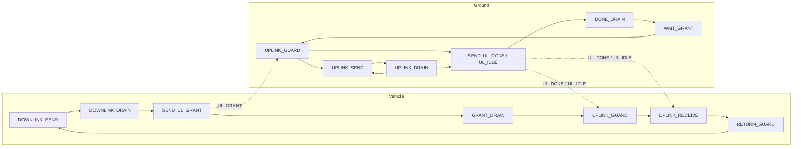

# VC LoRa 明示TDDプロトコル

適用仕様: VC-LORA-HTS-001 v2.0 / Phase 1～6  
検証結果: CTest runner 179/179件成功（177 normal PASS＋2 expected negative＋0 unexpected FAIL）  
deployment状態: R17 Ground USB Heartbeat 3枠予備版はArduino同期・clean compile済み、未flash・未HILのため**NO-GO**。

## 状態遷移



Vehicleは`UPLINK_GUARD`および`UPLINK_RECEIVE`中にradio TXしない。Groundは有効なGRANT leaseを
持つ場合だけ上りpayloadまたは対応するDONE/IDLEを送信できる。窓は
`guard_deadline <= now < window_deadline`の半開区間であり、300 msは**新しいwhole-frame
transactionの承認／開始期限**である。開始前にselected descriptorの全wire byte数をpreviewし、
固定上限内であることを確認する。窓内で最初のprefixがAcceptedとなった後は、新規frameは開始せず、
同一のlatch済みtransactionのみを550 ms service-floor pacingで有界に最後まで継続し、その後に
明示`UL_DONE`を送信する。window経過だけでpartial `UL_DONE`に切り替えない。

GRANTの固定650 ms guardはUART受付時ではなく、accepted GRANTが物理的にdrainした点Qを
epochとして開始する。これによりE220の550 ms service-floor completion dwellがguardを消費せず、
Q以後に全量650 msを確保する。通常の`UPLINK_RECEIVE` timeout後は、同一cycleの遅延transactionに
限定したlate recoveryを`RETURN_GUARD`中に開く。timeout起点の`late_terminal_wait_ms=1300`は
絶対floorで、raw radio活動はdeadlineを`max(existing, raw_now+650 ms)`で延長するだけである。

VehicleはGuard/Receive/timeout-originated ReturnGuardをまたいで最大64 application byteを隔離bufferに保持する。
v2のdata cycleは1 GRANTにつき1 CRC-valid complete MAVLink frameとmatching `UL_DONE`を必要とする。
Vehicleはframe全体とterminalのidentity/lengthを照合した後だけD6/local egressへatomic commitする。
`UL_DONE.actual_bytes`はAcceptedとなったapplication byteの合計である。空cycleだけは
session/cycleを照合した`UL_IDLE`で完了する。
CRC/identity/length/overflow異常はtransaction全体を破棄する。

Vehicleは`DOWNLINK_SEND`期限に達した後、新しいMAVLink frameは開始しない。
ただし、期限前に開始したactive frameは中断せず、末尾まで物理writeした後に
`DOWNLINK_DRAIN`へ移る。これによりローカルUARTに部分MAVLink frameを渡さない。

CRC合格済みの実Heartbeatを一度観測すると、Vehicleは各cycleの
`state_entered + 3000 ms`をnominal anchorとして、1100 msのheartbeat tail選択窓を
有効にする。poll時刻から相対的に延長しない。選択対象は固定schedulerに存在する
実Heartbeatだけで、合成Heartbeatや通常frameは対象外である。

- nominal境界から1100 msのinclusive endpointまでにHeartbeatがなければ有界drainする。
- 実Heartbeatを選択しても、送信には同じframeの`heartbeat_tail_available`、AUX High
  15 ms安定、radio readiness、550 ms service floorをすべて要求する。
- selected latchはUART/AUX busyやRejectedをまたいで同一active frameを保持する。
  availabilityが消失したままendpointへ達した場合はselectionを解除してdrainし、
  後続の通常frameへtail権を渡さない。
- 一度物理送信を開始したHeartbeatはCRC完全性を守るため末尾まで完了し、2 frame目を
  tailとして開始しない。signed MAVLink 2やescape後のmulti-writeも同じ規則である。
- selected Heartbeatのzero writeは同一prefixをexact retryする。partial writeまたはAUX LOW
  2 s継続はruntime fail-closeし、通常frameまたはGRANTへfail-openしない。

1 GRANTの上りapplication予算は既定で最大64 byteで、診断上は最大1件の
論理transactionとして数える。実機E220への1回の物理writeは最大32 byte、
同一nodeのwrite開始間隔は550 ms以上とする。180 msは従来の下限として維持するが、
production runtimeで550 ms floorが支配する。

64 application byteが常に64 wire byteに収まるとは限らない。`0x56`/`0x7D`のescapeにより
wire byteが増えるため、adapterはqueue先頭から選択した完全frame全体をpreviewし、
`next_tx_application_bytes`と`next_tx_wire_bytes`をcontrollerへ渡す。32 wire byteは1 DATA、
64 wire byteは2 DATA＋DONEとして開始後は300 msを越えても有界完遂し、Vehicleの2000 ms
receive timeout内にterminalまで収める。96 wire byteまたはoversize descriptorは開始前に拒否し、
prefix 0の`UL_IDLE`とする。`UL_DONE.actual_bytes`はwire byteではなく、Acceptedとなった
application byteの合計である。

`partial_flush_ms=50`は旧raw-byte stagingで32 byte未満を保持できる最大時間を固定した
互換定数で、Phase 6 production pathのtimer判断には未使用である。frame-aware経路はcomplete MAVLink frameだけをqueueし、active
frameの32 byte未満tailを別の50 ms timerで待たせず即時eligibleにする。local staging遅延は
0 ms、すなわち50 ms以内である。TDD state/admission-windowと550 ms service-floor pacingによる実際の送信待ちは
この`partial_flush_ms`には含めない。

## Ground USBリングバッファ

Phase 3のホストcore/simulatorは、TDD状態から独立した固定16 KiB
`ByteRingBuffer`へGround USB相当入力を格納する。動的確保は行わず、FIFO順序を
維持する。入力が空き容量を超えた場合は、すでに待機しているbyteを保持し、
新しい入力の末尾をdropする（drop-newest）。

- `WAIT_GRANT`を含む全状態でingress APIは入力を受理できる。
- RF出力はTX gateが有効なGRANT内のpayloadを許可した場合だけ行う。
- adapterはring先頭をpeek/copyしてからE220へ渡す。
- E220書込みのissue時またはRejected時はringを変更しない。
- Accepted時だけ、その物理書込みbyte数をring先頭からdiscardする。
- 拒否後に追加入力が来ても、再送される旧先頭、追加入力の順序を維持する。

診断は`ground_usb_rx_bytes`、`ground_usb_accepted_bytes`、
`ground_usb_dropped_bytes`、`ground_usb_dequeued_bytes`、
`ground_buffer_overflow_count`、`max_ground_queue`、
`ground_payload_order_errors`、`ground_queue_underflow_count`を記録する。
Phase 6 production Ground adapterはnative USB CDCを常時pollし、Mission Planner→RF方向を
このframe-atomic ingressへ接続する。USBへbackpressureを返せずcomplete frameを受理できない
場合はdropを記録してfail-closeする。

逆方向のRF→Ground USBは固定4 KiB local egressを使う。旧binaryはGround COMを約112秒
開かなかった実機HILで、容量超過を永久`runtime_fail_closed`へ伝播した。修正後は空き容量へ
入らない新しいCRC合格済みcomplete frameだけをdrop-newestとして記録し、既存FIFOとpending
short-write suffixを保持したままTDD/radioを継続する。USB書込みが再開すればresetなしにFIFOを
drainする。Vehicle→Pixhawkのlocal egressは同じoverflowを運用異常としてfail-closeする。
Ground USB出力はMAVLink frameだけで、文字列・独自binary・制御frameを流さない。

Phase 4のMAVLink ingressはstream parserでCRC合格した完全frameを確定してから、
frame全体をringへatomicに受理する。空き容量が不足する場合は部分frameを
入れず、対象frame全体をdropとして診断する。

## 制御フレーム

全現行制御フレームはprotocol version 2のexact 32 byte、little-endianである。

| Offset | 長さ | 内容 |
|---:|---:|---|
| 0 | 4 | magic ASCII `VCTD` |
| 4 | 1 | version=`2` |
| 5 | 1 | type: `1=UL_GRANT`, `2=UL_DONE`, `3=UL_IDLE`, `4=LINK_STATUS` |
| 6 | 1 | payload length=`12` |
| 7 | 1 | reserved=`0` |
| 8 | 2 | session_id |
| 10 | 2 | cycle_id |
| 12 | 2 | guard_ms |
| 14 | 2 | window_ms |
| 16 | 2 | max_bytes |
| 18 | 2 | actual_bytes |
| 20 | 10 | reserved padding=`0` (offset 20～29) |
| 30 | 2 | CRC16 (offset 30～31) |

CRCはoffset 0～29に対するCRC-16/CCITT-FALSE、polynomial `0x1021`、
initial value `0xFFFF`、xorout `0x0000`である。decoderは固定長、magic、
payload length、reservedの構造を確認し、次にCRCを検査し、その後でversionと
typeを検査する。CRC不正時はversion/typeを評価せず、状態機械へ渡さない。
検査に合格した制御フレームはリンク層で消費し、PixhawkまたはMission Plannerの
UARTへ流さない。

ホストRF経路の制御/データ分類は、呼出側から渡す真偽metadataではなく、実際に
送信されたbyte列に基づく。固定容量`TddLinkDemux`はUART/RF read境界をまたぐ
`VCTD`候補を保持し、通常データと連結された複数の制御フレームも順に抽出する。
CRC/padding/version/type異常を含む32-byte制御候補はリンク層で消費する。
旧candidateは混在streamから次のvalid v2 frameへresyncするため隔離するだけで、
現行controlとしてはdecodeしない。

Phase 4ではデータbyteの`0x56` (`V`)、escape prefix `0x7D`、padding marker `0x7E`を次のように
符号化する。制御frameは符号化せずrawで送る。

```text
application 0x56 -> wire 0x7D 0x76
application 0x7D -> wire 0x7D 0x5D
application 0x7E -> wire 0x7D 0x5E
other byte       -> wire unchanged
```

encoderはescape pairを物理write境界で分割せず、nonempty wire outputをraw `0x7E`で
exact 32 byteへpaddingする。demuxはunescaped raw paddingだけを破棄し、escaped `0x7E`は
元のapplication byteとして復元する。
demuxは分割されたescape prefixを保持し、unescapeしたdataは`VCTD`検出を
bypassしてendpointへ渡す。これによりMAVLink payload内のraw `VCTD`も保存する。

escape modeのwire上でraw `V`はdataとして現れないため、常に制御候補の開始と
みなす。後続の`C`、`T`、`D`、payloadまたはCRCが破損していても、32 byteの
quarantineが完了するまで保持する。decode結果は無効制御として扱い、候補byteを
MAVLink endpointへは流さない。

`UL_GRANT.max_bytes`と`UL_DONE.actual_bytes`はwire byteではなくapplication byteである。
adapterは符号化したwire writeがAcceptedになった場合だけ、対応する
application byte数をcontrollerとqueueへcommitする。Rejectedでは0 byteをcommitする。

## MAVLink frame処理

- `MavlinkStreamParser`は固定280 byteでMAVLink 1/2を扱い、完全frameまで保持する。
- MAVLink 1は`payload + 8`、MAVLink 2は`payload + 12`、signed MAVLink 2はさらに
  13-byte signatureを含む。未知incompatibility flagは受理しない。
- ローカルMission Planner `MAVLink.dll`と照合した80 msgidのCRC extraを持つ。接続・操作・
  parameter・command・mission・log系46件とtelemetry/status系34件で、`SET_MODE`、
  manual/RC、guided setpoint、log転送を含む。
- CRC不正や未知CRC extraのframeはendpointへ渡さない。CRC合格後だけ
  message IDによるfilter/schedulingを行う。
- `MavlinkFrameScheduler`は動的確保を使わない。通常/urgent/heartbeat用の固定8 slot、
  `PARAM_VALUE`用1024-frame / 64-KiB generic FIFO、matching target用固定8-frame laneを分離する。
  target laneは、D6へ受理済みの`PARAM_REQUEST_READ`を固定8件で追跡し、一致するD7応答だけを
  generic backlogより先に選択する。generic FIFOはdrop・並べ替えしない。
- index指定requestでは未使用`param_id`をidentity比較から除外する。target system/componentの0は
  MAVLink broadcast wildcardである。1つのresponseがID requestとindex requestに重なる場合は、
  Pending ownershipを先に各slotへ1件ずつ割り当て、Pendingが無い場合だけqueued duplicateをfilterする。
- production相当integrationは、旧generic 18件をschedulerから直接消費せずactual Ground parserまで
  byte-exact FIFOで配送し、550 ms same-direction completion floor、647 ms direction reverse quiet、
  32-byte physical write上限と全gate/timeout/control CRC/parser診断0を固定する。またactual primary
  RF heartbeatのsequence/wire一意性と、warm-up後の各4到着span <= 6200 ms（3 unique/trailing
  6200 ms、実測最大5159 ms）を固定し、Ground USB pacer/ordered-commit契約の供給前提とする。
- active frameは中断・プリエンプトしない。Rejectedのprefixは消費せず、
  Acceptedのapplication byte数だけ送信offsetを進める。
- 有効な`PID_TUNING` (194)は明示filterし、frame/byte数を診断する。

message definitionのCRC extraとpayload min/maxは80件を固定する。MAVLink 1は
minimum lengthと一致する場合だけ受理し、MAVLink 2は許容されたmin/max内の
末尾切詰め/拡張fieldを扱う。全一覧は`core/src/mavlink_frame.cpp`を正とし、下表は
主要E2E golden fixtureの代表値である。

| msgid | message | CRC extra | payload min/max |
|---:|---|---:|---:|
| 0 | HEARTBEAT | 50 | 9/9 |
| 20 | PARAM_REQUEST_READ | 214 | 20/20 |
| 22 | PARAM_VALUE | 220 | 25/25 |
| 23 | PARAM_SET | 168 | 23/23 |
| 76 | COMMAND_LONG | 152 | 33/33 |
| 77 | COMMAND_ACK | 143 | 3/10 |
| 194 | PID_TUNING | 98 | 25/33 |
| 345 | PARAM_ERROR | 209 | 21/21 |

`PARAM_ERROR` (345)はArduPilotの無効`ARMING_CHECK`要求に対する実Pixhawk frameと
独立fixtureでCRC extra 209、payload 21/21を確定し、urgent scheduler/egressへforwardする。

診断はMAVLink frame入力/配送/filter、msgid 194 frame/byte、CRC error、parser reset、
queue drop frame/byte、部分frame配送、queue最大frame/byte、heartbeat合格数/最大間隔、
PARAM/COMMAND要求・応答数を記録する。

Vehicle schedulerでは`SYSTEM_TIME` (2)と`TIMESYNC` (111)を独立bucketで各1 Hzに制限する。
一方が他方の送信枠を消費しない。

## Phase 4 fixtureと検証条件

Mission Planner相当の主要E2E fixtureはraw固定配列である。
`tests/host/fixtures/mavlink/MANIFEST.md`にMission Planner 1.3.83 build 1.3.9384.38258、
MAVLink.dll product version `1.0.7+b78a7495fec69793f2fcc13be4b6a3d9e06b3e4e`、DLL SHA-256、
`ardupilotmega` dialect、各CRCを記録する。595-byte burstは35-byte `PARAM_SET` 17 frameで、
各17 CRCと連結SHA-256をmanifestの独立golden値に照合する。

全Phase 4 E2Eは次を各testの共通invariantとしてassertする。

```text
physical_write_bytes <= 32
same_node_remote_service_completion_gap_ms >= 550
new Ground transaction start < corresponding GRANT window deadline
started Ground transaction continuation == same latched descriptor
action_retries == 0
```

Phase 4はcontrol v2、明示`UL_DONE`、Guard epoch、late atomic recovery、`UT-MAV-011`を含む。
`UT-MAV-BOUNDARY-003`～`008`はno-HBの有界drain、
inclusive endpointの実Heartbeat 1 frame、busy/selected latch、availability消失時の
normal不送信、signed 34-byte Heartbeatのescape/Rejected exact retry、AUX High 15 ms
安定待ちを固定する。`E2E-MAV-010`はHeartbeat停止2周期が各nominal+1100 msで
有界GRANTへ進み、再開Heartbeatが次周期のtailでexact deliveryされることを確認する。

## session/cycle規則

16 bit番号の順序は次のmodular差で判断する。

```text
delta = uint16_t(candidate - current)
delta == 0             : duplicate
1 <= delta < 0x8000    : newer
delta >= 0x8000        : older/rollback
```

同一sessionのcycle jumpは既定32まで受理する。それを超えるforward jumpは
診断して拒否する。`0xFFFF -> 0x0000`は距離1なので正しい進行である。

Ground再起動後は最初の正常GRANTを基準として受理し、それ以前の送信権を
保持しない。Vehicle再起動時は新しいsessionを使用する。Groundが新sessionを
受理すると旧lease・旧cycle・byte予算を破棄し、後着した旧sessionを拒否する。
同一cycleの重複GRANTは状態、deadline、予算を再初期化しない。

Phase 6 adapterはNVSの6-byte identity（32-bit `boot_id`＋16-bit `session_id`）を読出し、
非0の次値を生成して書込み・readbackしてからleaseする。最大値の次は0ではなく1である。
read/write/readbackのいずれかが失敗すれば通常radio TXを開始しない。wire上のVehicle
`session_id`はこの永続値を使う。production時刻はArduino 32-bit `millis()`ではなく
`esp_timer_get_time()`をmsへ変換した64-bit monotonic timeであり、hostの`FW-TIME-001`は
32-bit抽象clockを使う場合のwrap拡張・後退fail-closeも固定する。

## AUXと送信完了

action発行、UART受付、runtime write完了は別イベントである。write前はAUX HIGHの
既定15 ms安定と32 byte以下の全量受付を要求する。zero writeはqueueをcommitせず同一prefixを
再試行できる。partial writeは送信済みprefixが確定できないためfail-closeする。

E220公式の400-byte内部buffer仕様では、32 byte以下の各UART write後にAUX LOW pulseが
必ず発生するとは保証されない。HILで観測したremote sub-packet service間隔550 msを
`FixedFirmwareContract::e220_subpacket_service_floor_ms`とし、full write後の契約を次の二経路とする。

- AUXが連続HIGH: full write受付時刻から550 ms未満はbusy、550 ms経過かつHIGH連続15 msでone-shot完了。
- 途中でAUX LOWを観測: full write受付時刻をfloor起点として保持し、550 ms経過かつ
  再HIGH連続15 msまでbusy。LOWが2 s継続すればfail-close。時刻後退もlatchして復帰不可とする。

production adapterはUART全量Accepted時にsource/controllerをcommitするが、runtime completionまで
`radio_tx_empty=false`を保つ。AUX HIGHは内部bufferへ追加投入できることを示すが、最終packetの
RF送信完了や相手の受信成功を保証しない。180 msはminimum TX gapの従来下限だが、
productionで550 ms service floorが支配する。TDDの650/300/2000/650 ms guard/timeoutは別契約として維持する。

最初のDATA prefixをUARTがAcceptedとした時刻からVehicle receive timeoutと同じ2000 msを
started-transactionの絶対deadlineとする。その後`availableForWrite()`/`radio_tx_empty`が永続して
false、またはHardwareSerial write=0/Rejectedが反復し、DATA＋`UL_DONE`の物理完了がこのdeadlineに
間に合わない場合は、partial DONEや次cycleへのprefix持越しを行わずruntime fail-closeする。
deadlineと同一tickで既に観測可能なDONE drain completionはtimeoutより先に受理する。
`UT-GROUND-BOUNDED-CONTINUATION-001`はbusy永続、zero-write拒否反復、境界completion、
fail-close後の重複re-admission 0を固定する。

## ホストRFモデル

- E220 UARTは115200 bps、8N1相当の10 bit/byteとして送信時間に加算する。
- RF airtimeは19.2 kbps、sub-packetは32 byte、buffered-air service floorは550 msとする。
- 送受信が時間的に重なる場合は衝突として扱う。
- フレームの受信区間が受信側自身の送信区間と重なった場合は、半二重制約により配送せず
  `half_duplex_drop_count`を増加させる。
- 方向転換500 msを満たさない送信は`turnaround_drop_count`、400 byteのUART
  バッファ上限を超える送信は`uart_buffer_drop_count`へ記録して配送しない。
- AUXは送信側のUART/RF busy、受信区間、試験で注入する外部busyを表す。
  buffered modelはUART約3 ms後に550 msのair serviceを開始するため、production floorで次writeを受理した
  瞬間に最大64 byteが共存し得る。これは累積せず、remote completion間隔550/551 ms、
  方向転換quiet 654 msを`IT-E220-BUFFERED-UPLINK-001`で確認する。550 msはremote service
  spacing floorであり、buffer完全空を保証する値ではない。

## Phase 5 robustness検証

Phase 5は既存の3000/650/300/2000/650 ms（downlink/guard/admission-window/receive-timeout/return）、
timeout起点のlate terminal 1300 ms floorとraw活動から650 ms延長、
32 byte、180 ms minimum lower boundなどの固定値を変更せず、
固定seed `20260817`で次を検証した。

- 本番timingの10000周期でGRANT/DONE 10000/10000、上り640000 byte、
  下り320000 byteを配送し、drop、timeout、collision、誤送信を0に保った。
- 2000周期の1% RF lossは32件発生し32/32復帰、最大復帰2周期、最終pending 0だった。
  0.1% control corruptionは3件発生し3/3復帰、最大復帰1周期、最終pending 0で、
  CRC異常による状態遷移は0だった。
- Ground/Vehicleの交互再起動10件は各1周期でsessionを再同期した。
- Ground AUX Busy 400～1000 msを1000周期連続注入してもdeadlockせず、
  受理した32000 byteを全て配送した。
- 115 byte/10 msを60 s入力した過負荷では、固定16 KiBリングへ受理した
  17184 byteを順序どおり全配送し、残り672816 byteをdrop-newestとして明示計上した。
- 本番MAVLink経路`ST-MAV-001`は10000周期、heartbeat 49995、最大gap 1720 ms、
  GRANT/DONE 10000/10000でPASSした。vehicle/ground exact rolling hashは
  `11334217462533280590` / `7893383440479344794`、queue high-waterは1 frame/35 byte、
  drop/CRC/partial/leak/hash mismatch/action retryは0だった。
- `ST-MAV-PHASE-001`はheartbeat初期位相0～999 msを各6周期、計6000周期実行し、
  基準超過0/1000、worst gap 1720 msだった。各位相末尾のno-HB 2周期も有界に
  GRANTへ進み、deadlock、tail timeout、予期しないdrop/retryは0だった。
- 非CTest補助ID `ST-MAV-001-Q1`は1 ms量子で10000周期、heartbeat 49995、
  最大gap 1870 ms、同一hash、GRANT/DONE 10000/10000、drop/partial/retry 0でPASSした。
  canonical証拠は`runs/diagnostics/ST-MAV-001-Q1/summary.json`で、CTest 132件へ含めない。
- 修正前の2720 ms（5 ms量子）と2690 ms（1 ms量子）は現行結果ではなくRED証拠である。
  前者の実イベント201件固定窓は
  `runs/diagnostics/ST-MAV-001-pre-tail/{summary.json,trace.csv}`、後者は
  `runs/diagnostics/archive/ST-MAV-001-Q1-legacy/diagnostic_summary.json`に保存する。
- `ST-003`は独立RF random corruption 3件とdecoder CRC error 3件が1:1一致し、
  targeted corruptionは0だった。
- online invariantを各stepで検査した。traceは最大2048 event、RF履歴と配送待ちの
  実測high-waterは各1 transmission、最終pendingは0だった。

Clang 22.1.8のAddressSanitizer/UndefinedBehaviorSanitizer有効buildでもPhase 5の
8件を実行し、8/8 PASS、ASan/UBSan reportは0だった。WindowsではLeakSanitizerを
利用できないため`detect_leaks=0`であり、leak検出はこの結果の対象外である。

service-floor旧baselineのfresh full sanitizerは161/161成功し、ASan/UBSan/runtime-error markerは0だった。
2026-08-25 target priority baselineもClang 22.1.8 ASan+UBSanの専用fresh buildで167/167成功し、
ASan/UBSan/runtime-error markerは0だった。normal/sanitizer証拠とfreeze manifestは
`runs/validation/VEHICLE-TARGET-PARAM-PRIORITY-AUDIT-002/20260825T121001641Z/`に固定する。

canonical summaryの`reproduce`は、bare command名ではなく
`.\build\host\tests\host\vc_lora_host_tests.exe`から始まる実行可能なコマンドである。
補助診断の再現コマンドは次のとおりである。

```powershell
.\build\host\tests\host\vc_lora_host_tests.exe --test-case=ST-MAV-001-Q1 --seed=20260817 --output-dir=runs/diagnostics/ST-MAV-001-Q1 --trace=runs/diagnostics/ST-MAV-001-Q1/trace.csv
```

## Phase 6 firmware統合と判定

明示TDD、link escape、80-msgid MAVLink parser/scheduler、fixed ingress/egress、runtime契約は
Arduino非依存C++17 coreである。Vehicle/Ground production wrapperは
このcanonical core source/headerと`firmware/phase6/vc_lora_phase6_bridge.hpp`のコピーを
各スケッチフォルダへ同梱する設計とし、NVS、`esp_timer`、UART、GPIO、USBへ接続する。R17
canonicalはproduction/diagnostic計4 sketchへ同期・hash一致確認済みで、production
Vehicle/Groundのclean compileもPASSした。R17 binaryは未flashである。Arduino IDE直開きで
外部`VC_LoRa_Core` libraryは不要である。`.ino`、`VC_LoRa_Core.h`、local adapter、`vc_lora/`、
`src/`を含むスケッチフォルダ全体を保持する。canonical変更時の同期は
`tools/sync_arduino_sketch_core.ps1`を明示実行し、contractでファイル集合とSHA-256一致を検査する。

- Ground native USBは常時pollされ、MAVLink以外のprint/printf/diagnostic byteは0である。
- 固定16 KiB complete-frame ingressとlocal suffix retry adapterを使用する。
- Ground USB local egress overflowはcomplete-frame drop-newestとして非fatal、Vehicle側はfail-closeとする。
- 80 msgidのCRC/payload定義、固定scheduler、`SYSTEM_TIME`/`TIMESYNC`各1 Hzを使用する。
- NVS identity readback、E220 profile exact verifyが成功するまでradio TXを許可しない。
- radio full writeだけをcommitし、zeroはexact retry、partial/AUX timeoutはfail-closeする。

次の既存条件はcompile-time contractとして維持する。

- E220: `D0=M0`, `D1=M1`, `D2=XIAO TX -> E220 RXD`,
  `D3=XIAO RX <- E220 TXD`, `D8=AUX`
- Pixhawk: `D6=XIAO TX -> Pixhawk RX`, `D7=XIAO RX <- Pixhawk TX`
- Pixhawk/GCS UART 57600 bps・8N1、E220 UART 115200 bps・8N1
- E220プロファイル `00 00 E5 C3 46 00 00 00`
- 物理write最大32 byte、partial flush 50 ms、minimum TX gap 180 ms（下限）、
  E220 remote service floor 550 ms

`FW-USB-DISCONNECT-001`ではGround queueに3 frame/63 byteを保持し、7-byte partial write後も
100 frameを新しいframe単位でdropした。fail-closeせず、再接続FIFO、容量exact/1-byte不足境界、
再開後frameがbyte-exactで、Vehicle strict policyも維持した。R17 canonicalのhost全件は
177 normal PASS＋2 expected negative＋0 unexpected FAIL（CTest runner 179/179）である。transport GREENは
`runs/e220_service_floor_vehicle_transport_green/summary.json`、started-transaction watchdog GREENは
`runs/e220_started_tx_bounded_green/summary.json`に保存する。RF schedule単体のHeartbeat 2500 ms契約は
`IT-E220-BUFFERED-RF-HB-RED-001`で別のexpected XFAILとし、transport成立と混同しない。
前者は45-byte MAVLink frameを2 DATA＋explicit DONEで実Vehicle controller/demux/quarantineへ通し、
RX epoch 4202 ms、DONE air 5861 ms、deadline margin 341 ms、byte-exact atomic commit 1、
partial/discard/outside/timeout/collision/loss 0を記録する。

`IT-E220-BUFFERED-VEHICLE-PARAM-PRIORITY-001`はactual Vehicle/Ground TDD controller、
`RfMediumSim`、production `E220WriteContract`相当の550-ms gateを使う。#20をRF transactionから
D6へexact once admissionした後にidentityをrememberし、D7順で旧`PARAM_VALUE` 18件、target、
1-Hz real heartbeatを投入する。targetはrequest originから7614 ms（D6/target enqueueから2304 ms）で
Groundへexact once到達した。旧18件もsynthetic drainせず39 cycleを通してactual Ground parserへ
全件exact FIFOで到達した。target周辺のRF scheduler fairness gapは1650 ms、full-run RF最大gapは
2959 ms、drop/gate/collisionは0だった。
これはUSB SLA全体の代用ではない。Ground USBの2500-ms SLAは
`IT-GROUND-USB-HB-PACER-TIMING-001`、Phase6 ordered-commit tests、および
R16実測の空上り周期を再現する`IT-GROUND-USB-HB-PHASE6-PREGRANT-RESERVE-001`で拘束する。
R17の固定3枠予備はcounterfactual最大`2951 ms`を`2401 ms`へ短縮し、Heartbeatと
`PARAM_VALUE`のbyte-exact FIFO順序、hold age`<=2400 ms`、drop/CRC/partial 0を維持した。

以下のsize/hashは**550 ms service-floor変更前の履歴build**であり、現行canonical sourceの
compile/書込み証拠ではない: Vehicle/Ground binary
`445545EEC6DE0CCED1A3105D539D80C77C6612A078CE52900218AF6939F88C3D` /
`C7778087E42D546662C10D7F2415298920C6FFCDA2BE87D769E9FDD249F1798B`。
旧service-floor baseline compileの正本は`runs/validation/final_production_compile_20260823T192757014Z/`で、Vehicle/Ground appは
391952 byte / `4431DCB13DF662F91413700A8B2EFFE2F6A9E2A03473B6C3419C9C6C7CDBFC86`、
364144 byte / `095C9BE529DFA24A544CAE544801B9E5D702CB181AFB87DBBD6DC62DAE334BCB`である。
source treeは`B835173B1AA3837CEBDB94F1F0AEBFBC682EA0084E6A5E7D41F0C134DD2EE2D6`、
manifestは`BBE61DE437D8E624A8016A53AAFC72C43B5C12ED9038C54FFEE72B7393EB56E0`である。
同じ旧baselineのVehicle COM3→Ground COM6順の標準4領域uploadもPASSし、正本は
`runs/hil/PROD-V2-PACING-HB-UPLOAD-001/20260823T194053048Z/`である。完全電源再投入とHILは未実施である。

- **Software / preflight: GO**
- **Deployment: NO-GO** — R17 canonicalはArduino同期・clean compile済みだが、
  R17 upload・COMアクセス・Mission Planner実機再試験は未実施。

以下はR16より前の履歴切り分けであり、現在の未解決境界を示すものではない。変更前のv2 binaryはVehicle COM3→Ground COM6順に書込み済みだった。診断HILは遅延msg20と
matching DONEをatomicに完了し、D6 driver受付msg20=1、timeout=0を示した。
しかし旧v2 production HILはrequest msg20=1に対しresponse msg22=0、Heartbeat最大gap
4098.309 ms > 2500 msでFAILした。直結Pixhawk controlは同一fixtureでmsg22応答を確認済みで、
当時の未解決境界はD6→flight-controller受信/応答だった。その後R16でMission Plannerから
932件をexact取得済みであり、R17の未完了項目はHeartbeat予備修正後の再書込み・再測定である。
証拠はproduction `judgment.json`、`pixhawk_serial_parameters_readonly.json`、compile配下の
`flash_evidence.json`である。read-only値はSERIAL1/2_PROTOCOL=2、BAUD=57、OPTIONS=0、
MAV1/2_OPTIONS=0、BRD_SER1/2_RTSCTS=2 (Auto)で、要求値0との差を次の切り分け対象とする。
