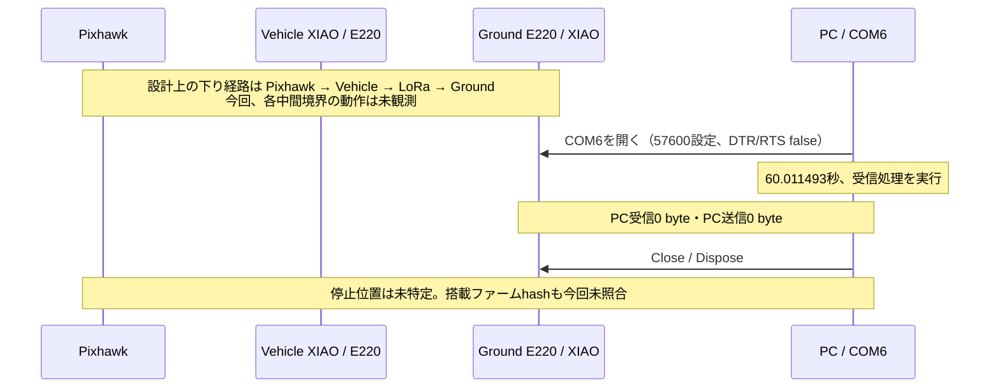
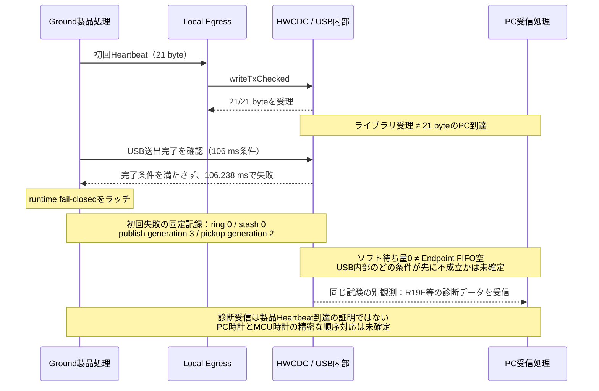
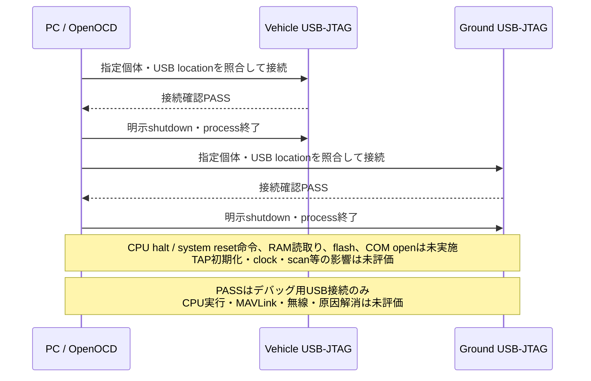

# 通信問題のシーケンス図

2026-10-21時点。異なる試験を3図に分け、観測済みの事実と未観測の経路を区別します。
「データ受理」「USB送出完了」「PC受信」「無線到達」「全パラメータ取得」は別の判定です。

## 1. 現接続状態の60秒受信確認

受信0 byteは実測ですが、RF部分やUSB FIFOの特定位置に停止印を置ける証拠はありません。
この試験はCOM3を開かず、書込み・JTAG・payload送信・reset要求を行っていません。

## 2. 過去R19：Groundの初回Heartbeat完了条件失敗

このrunは各COMで2,646 byte・42完全診断frameを取得しましたが、製品frameは0件です。
後から取得したFIFO状態を、初回失敗時点のFIFO状態に置き換えてはいけません。
試験終了時にはaccepted R18へ復旧していますが、この事実だけで復旧後の通信成立まで証明したとは扱いません。

## 3. 最新USB-JTAG接続確認

結論：現在はPC受信0 byte。過去R19にはUSB完了待ち失敗の証拠がありますが、今回と同一原因かは未確定です。
JTAG接続成功は通信復旧の証明ではありません。
